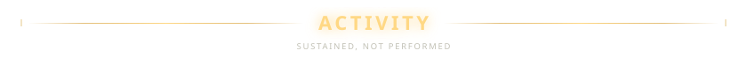
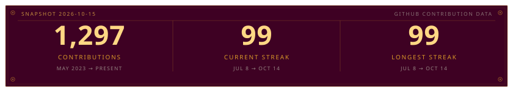
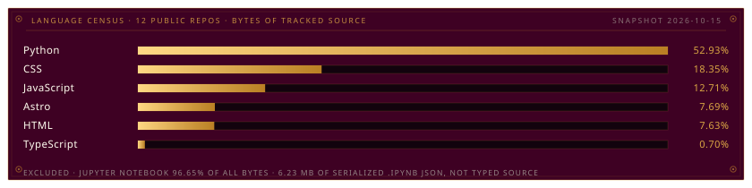
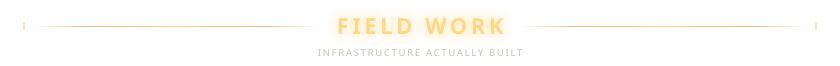
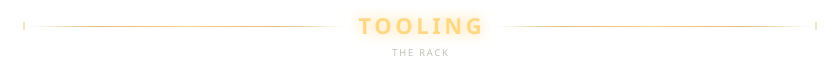
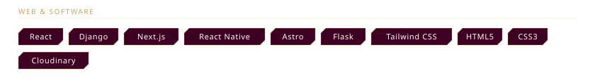
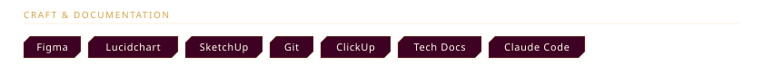
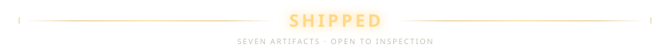
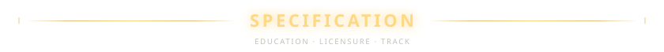
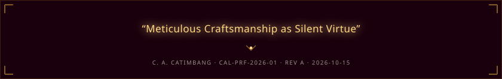

<!--
  CALFREDO — profile README source
  Render target: https://github.com/Calfredo23
  Measured constraints and design rationale: tools/README.md
  Assets in assets/ are GENERATED by tools/build.mjs — do not hand-edit them.
  Prove it: node tools/build.mjs --check   (renders to memory, diffs against disk, exits 1 on drift)

  Platform constraints this file is written around (all MEASURED, see plan §8):
    · GitHub strips <style>, inline <svg>, and every style=/class= attribute.
    · So: no HTML-styled typography exists here. Ornament + type identity live inside committed .svg files.
    · div align / img width / details / table / links all survive.
    · Theme: DARK ONLY by owner decision 2026-10-15. No light variant is generated.
    · GitHub's phone column is ~358 px. A sheet authored at 840 and stretched to it puts its
      10 px labels at 4 px, so every asset that carries type has a pocket twin re-authored at
      360 and the two are offered as branches of a <picture>. <picture>/<source media> survives
      the sanitizer; a browser downloads exactly one branch, so this costs a reader nothing.
-->

<picture>
<source media="(max-width: 767px)" srcset="assets/hero-sheet-pocket.svg" />

</picture>

<!-- ── ACTIVITY ───────────────────────────────────────────────────────── -->
<!--
  Deliberately NOT a github-readme-stats card. Measured on 2026-10-15 the account shows
  2 stars / 151 commits / 0 issues / contributed-to 1, against 1,297 contributions and a
  99-day streak. A stats card quantifies the shortfall; the plate does not.

  Dropped, with the measurement that killed each:
    · streak-stats.demolab.com — 200 OK, but the served SVG hardcodes fill='#FFFEFE' and
      '#151515' and ignores bg_color/text_color/num_color entirely (byte-identical responses
      with and without them). Only theme= applies, and across 63 probed themes nothing sits
      near this sheet's crimson+gold. It would be the one foreign palette on the page. The
      numbers are read from it instead and drawn here, by hand, until a workflow exists — which
      is what the SNAPSHOT date on the plate is for: a stalled refresh reads as a dated fact.
    · github-readme-activity-graph.vercel.app — 402, 78 B. Deployment disabled. It is broken
      on the live profile right now.
    · github-profile-trophy — 402, same. komarev view counter — removed, it counts strangers.
  top-langs dropped too, and for a different reason: it works, and its answer is a lie by
  denominator. Measured 2026-10-15 (tools/langs.mjs): 6.45 MB of tracked bytes, of which
  6.24 MB — 96.65% — is one repo's serialized .ipynb JSON. The card is one orange bar. The
  plate below reports the same census over source files and says so on its own face.
-->

<picture>
<source media="(max-width: 767px)" srcset="assets/head-activity-pocket.svg" />

</picture>

<picture>
<source media="(max-width: 767px)" srcset="assets/streak-plate-pocket.svg" />

</picture>

<picture>
<source media="(max-width: 767px)" srcset="assets/lang-ledger-pocket.svg" />

</picture>

<!-- ── FIELD WORK ─────────────────────────────────────────────────────── -->
<!--
  The one asset on this page no generator can produce: a gold line-art schematic of a network
  he actually built, drawn from his own description — see tools/content.js → topology.
  It stays commented out until that description exists. A plausible-looking topology invented
  here would be the most damaging thing on a hire-me page, so it is not fabricated and not
  linked. Uncomment both lines once assets/topology.svg is generated.

<picture>
<source media="(max-width: 767px)" srcset="assets/head-field-pocket.svg" />

</picture>
<picture>
<source media="(max-width: 767px)" srcset="assets/topology-pocket.svg" />

</picture>

-->

<!-- ── TOOLING ────────────────────────────────────────────────────────── -->

<picture>
<source media="(max-width: 767px)" srcset="assets/head-tooling-pocket.svg" />

</picture>

<picture>
<source media="(max-width: 767px)" srcset="assets/rack-languages-pocket.svg" />

</picture>
<picture>
<source media="(max-width: 767px)" srcset="assets/rack-web-pocket.svg" />

</picture>
<picture>
<source media="(max-width: 767px)" srcset="assets/rack-data-pocket.svg" />

</picture>
<picture>
<source media="(max-width: 767px)" srcset="assets/rack-systems-pocket.svg" />

</picture>
<picture>
<source media="(max-width: 767px)" srcset="assets/rack-craft-pocket.svg" />

</picture>

<!-- ── SHIPPED ────────────────────────────────────────────────────────── -->

<picture>
<source media="(max-width: 767px)" srcset="assets/head-shipped-pocket.svg" />

</picture>

Nothing here is a mockup. Open any of them.

<!--
  Three columns, deliberately. GitHub serves markdown tables as
  `display:block; width:max-content; max-width:100%; overflow:auto` — a table wider than the
  column scrolls rather than reflowing, and a cell's unbreakable longest word sets its minimum
  width. The five-column version of this table measured ~555 px of minimum content against a
  358 px phone column, so the column that fell off the right edge on a phone was Inspect: the
  links to the actual work. Stack and link now live under the name, which keeps the ledger to
  three columns (~261 px minimum) and puts the thing a recruiter came for in the part that is
  always visible.
-->

| # | Artifact | State |
|:-:|:---|:---|
| 01 | **Faith 'N Action** — parish events, forum, blockchain donation portal, analytics Django · PostgreSQL · Blockchain [open ↗](https://faith-n-action.onrender.com/) | `LIVE` cold-start ~40s |
| 02 | **VIEVE HD Makeup Studio & Salon** — booking and catalogue front end Next.js · Tailwind [open ↗](https://vieve-hd-salon.vercel.app/) | `LIVE` |
| 03 | **CampBook** — campsite reservation system, auth + booking + admin Next.js 14 · TypeScript · Supabase · shadcn/ui [open ↗](https://vigilant-sniffle.vercel.app/) | `LIVE` |
| 04 | **AreYouSure** — Chrome extension, MV3 confirmation gate JavaScript · Chrome MV3 [web store ↗](https://chromewebstore.google.com/detail/areyousure/pkoimnpnibjcnipehmaohgnloloppgkj) | `PUBLISHED` |
| 05 | **Criminal Records Management System** — PNP field IT, records + access control Django · PostgreSQL | `RESTRICTED` RA 10173 |
| 06 | **Police Data Encoder** — bulk record ingestion to formatted documents Python · Flask · python-docx | `RESTRICTED` RA 10173 |
| 07 | **Automated pH Monitor & LCD Display** — sensor logging, embedded firmware Arduino Uno · Embedded C | `ACADEMIC` |

<picture>
<source media="(max-width: 767px)" srcset="assets/head-spec-pocket.svg" />

</picture>

BSIT graduate who works on **both ends of the stack** — Django and React on the application side,
Cisco networking, hardware and cybersecurity on the infrastructure side — and who has had to keep
both talking to real users in a government field environment. Three years of that. Technical
support, system documentation and stakeholder communication are part of the job, not a footnote.

| Field | Value |
|:---|:---|
| Education | BS Information Technology — Dalubhasaan ng Lungsod ng Lucena · GPA 3.7 / 4.0 |
| Licensure | Civil Service Professional — Passed 2026 |
| Experience | IT Intern (OJT), Philippine National Police · 2025 – 2026 · 3+ yrs total |
| Track | Full-stack application development **and** IT infrastructure |
| Availability | **Open to work** |
| Location | Lucena City, Philippines |
| Elsewhere | [GitHub](https://github.com/Calfredo23) · [LinkedIn](https://www.linkedin.com/in/cedrick-alfredo-c-b162023a3) · [Facebook](https://www.facebook.com/Calfredo23) · [Discord](https://discord.com/users/734585074137301074) |

<!--
  The address is a paragraph, not a table row. A cell's minimum width is set by its longest
  unbreakable string and `overflow-wrap: break-word` — which .markdown-body does carry — does not
  reduce a min-content contribution. catimbangcedrickalfredo@gmail.com is 32 characters, ~250 px,
  which pushed the whole table past the 358 px phone column and clipped the Value column mid-word
  on every row. As a paragraph it wraps freely and stays copyable.
-->

Email — **[catimbangcedrickalfredo@gmail.com](mailto:catimbangcedrickalfredo@gmail.com)**

<picture>
<source media="(max-width: 767px)" srcset="assets/footer-plate-pocket.svg" />

</picture>

