<!--
  CALFREDO — profile README source
  Render target: https://github.com/Calfredo23
  Measured constraints and design rationale: tools/README.md
  Assets in assets/ are GENERATED by tools/build.mjs — do not hand-edit them.
  Prove it: node tools/build.mjs --check   (renders to memory, diffs against disk, exits 1 on drift)

  Page structure: the Calfredo hero, then one drawing — the hypergamy graph. Nothing follows the
  graph: every section below the handle and the contact line were removed on 2026-10-21 by owner
  direction. The retired section assets are still in tools/build.mjs for rollback, but they are no
  longer generated or referenced here.

  Platform constraints this file is written around (all MEASURED, see plan §8):
    · GitHub strips <style>, inline <svg>, and every style=/class= attribute.
    · So: no HTML-styled typography exists here. Ornament + type identity live inside committed .svg files.
    · div align / img width / details / table / links all survive.
    · Theme: DARK ONLY by owner decision 2026-10-15. No light variant is generated.
    · GitHub's phone column is ~358 px. A sheet authored at 840 and stretched to it puts its
      10 px labels at 4 px, so every asset that carries type has a pocket twin re-authored at
      360 and the two are offered as branches of a <picture>. <picture>/<source media> survives
      the sanitizer; a browser downloads exactly one branch, so this costs a reader nothing.
-->

<picture>
<source media="(max-width: 767px)" srcset="assets/hero-sheet-pocket.svg" />

</picture>

<!-- ── THE HYPERGAMY GRAPH ───────────────────────────────────────────── -->
<!--
  One drawing replaces activity, field work, tooling, shipped and specification. The joke is
  the shape of the old two-panel "hypergamy chart" meme applied to stacks: attention does not
  distribute evenly across a generalist's interests. The shares are AUTHORED FOR THE JOKE, not
  measured — the sheet prints "percentages are vibes, not telemetry" on its own face, which is
  the condition for drawing them at all. Relationship-status lines describe technologies only.

  The seal is the high-value node; six disciplines are the suitors; line weight follows share;
  pulses travel the live edges and the sleep edge is dashed and dead. Both sheets are vectors
  except the seal raster, and both are generated by tools/build.mjs from tools/content.js.
-->

<picture>
<source media="(max-width: 767px)" srcset="assets/hypergamy-pocket.svg" />

</picture>

